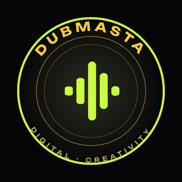
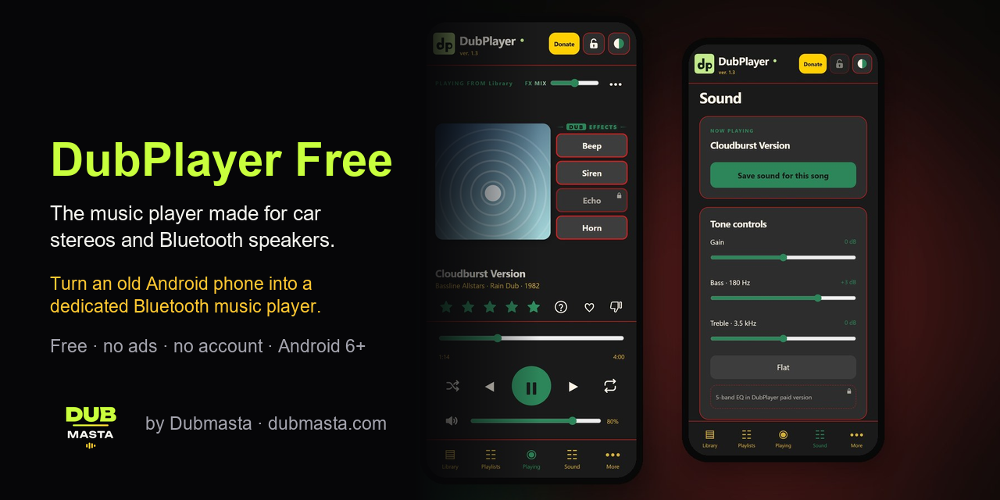

  

<h1 align="center">Dubmasta</h1>

  <strong>Digital Creativity · music, sound and apps</strong> 
  <a href="https://www.dubmasta.com/">dubmasta.com</a>

---

##  Projects

### 🎵 DubPlayer Free · Android music player

The music player made for **car stereos and Bluetooth speakers**. Random play that keeps your music fresh, dub sound effects, Subwoofer Bass and per-song sound. Free, no ads, no account.

**Turn an old Android phone into a dedicated Bluetooth music player** for your car or speaker.

[**⬇ Download DubPlayer Free**](https://github.com/Dubmasta/DubPlayer/releases/latest) · [Project page](https://github.com/Dubmasta/DubPlayer) · [dubmasta.com/dubplayer](https://www.dubmasta.com/dubplayer/)

---

  More projects at <a href="https://www.dubmasta.com/"><strong>dubmasta.com</strong></a> ·
  ☕ <a href="https://buymeacoffee.com/dubmasta">Buy me a coffee</a> ·
  ✉️ <a href="mailto:info@dubmasta.com">info@dubmasta.com</a>

